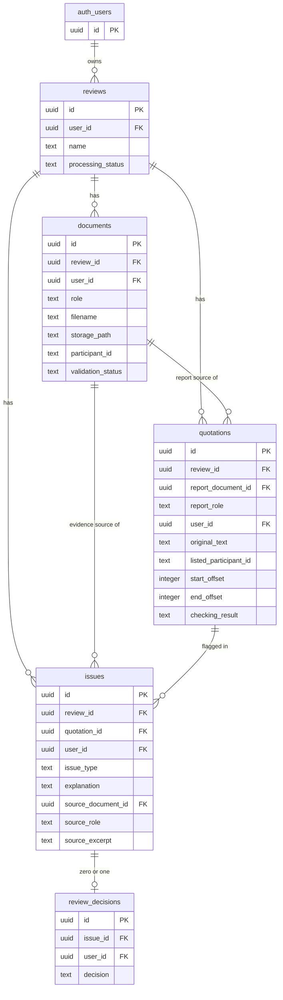

# Database diagram — Research Quality Auditor (MVP #1)

> **Draft** entity diagram (Mermaid), kept consistent with
> [`docs/database-design.md`](./database-design.md) — the authoritative source for
> columns, types, allowed values, and constraints. GitHub renders Mermaid. Timestamp
> columns (`created_at` / `updated_at`) are omitted here for readability; see the design
> doc for the full column list. **Open question / deliverable:** this may later be
> supplemented with a screenshot from Supabase's Schema Visualizer once the tables
> exist.
>
> The fixed-value columns `quotations.report_role` and `issues.source_role` are part of
> the composite foreign keys that force report links to point at a `report` document and
> evidence links at a `transcript`, within the same review (see the design doc's "Rules
> for linked records").

