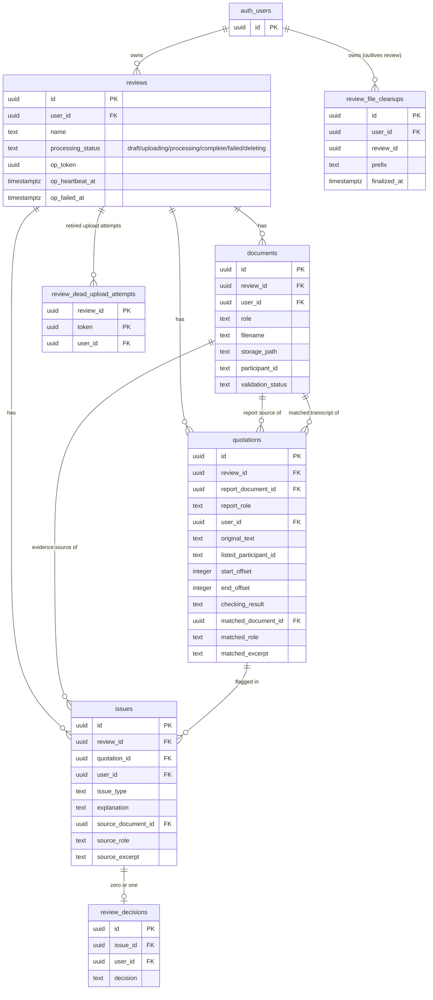

# Database diagram — Research Quality Auditor (MVP #1)

> **Draft** entity diagram (Mermaid), kept consistent with
> [`docs/database-design.md`](./database-design.md) — the authoritative source for
> columns, types, allowed values, and constraints. GitHub renders Mermaid. Plain
> `created_at` / `updated_at` columns are omitted here for readability; see the design
> doc for the full column list. **Open question / deliverable:** this may later be
> supplemented with a screenshot from Supabase's Schema Visualizer once the tables
> exist.
>
> The fixed-value columns `quotations.report_role`, `quotations.matched_role`, and
> `issues.source_role` are part of the composite foreign keys that force report links to
> point at a `report` document and evidence links (the quotation's matched transcript and
> an issue's source) at a `transcript`, within the same review (see the design doc's
> "Rules for linked records"). A quotation's `matched_document_id`/`matched_excerpt`
> record WHERE a verified quote was found; both are null for an unmatched quote.
>
> **Operation lifecycle (migration `20261112000000`).** `reviews` carries a per-attempt
> operation lease (`op_token`, `op_heartbeat_at`, `op_failed_at`) and an expanded
> `processing_status` set (adds `uploading`). Two owner-only bookkeeping tables track
> Storage cleanup: `review_dead_upload_attempts` — one row per retired upload-attempt
> folder, with a composite FK to `reviews` — and `review_file_cleanups`, a whole-prefix
> record that **deliberately has no FK to `reviews`** so it outlives a deleted review row
> (hence no edge to `reviews` below; it links only to the owner). `database-design.md`
> is pending an update to match.

